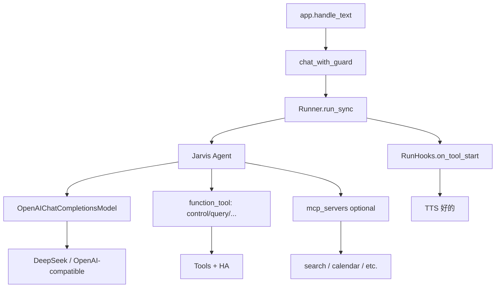

# Jarvis → OpenAI Agents SDK 改造

## 已定决策

- **工具层 A**：[`jarvis/tools.py`](jarvis/tools.py) 领域逻辑不动（别名解析、人话返回、少而稳契约）；用 Agents SDK `@function_tool` 包装，不把 HA 控制做成 MCP。
- **上线 B**：硬切到 Agents SDK，去掉手写 `DeepSeek.chat` tool-loop；不保留 `AGENT_RUNTIME` 双轨。
- **模型路径**：一律走 `OpenAIChatCompletionsModel` + `AsyncOpenAI(base_url, api_key)`，便于 DeepSeek / 其它 OpenAI 兼容网关切换；不用 OpenAI Responses Hosted MCP。
- **语音体验不降级**：保留 `chat_with_guard` 强制 `tool_choice`，以及工具决定后的「首句先出声」。

## 目标架构

## 核心改动

### 1. 新增 Agent 运行时 [`jarvis/agent_runtime.py`](jarvis/agent_runtime.py)

替代 [`jarvis/llm.py`](jarvis/llm.py) 的编排职责：

- 构造 `AsyncOpenAI(base_url=settings.llm_base_url, api_key=...)`
- `OpenAIChatCompletionsModel(model=settings.llm_model, openai_client=client)`
- `Agent(name="Jarvis", instructions=..., tools=..., mcp_servers=..., model=..., model_settings=...)`
- 对外保持近似现有契约，便于 [`jarvis/app.py`](jarvis/app.py) 少改：
  - `chat(messages | user_text, *, force_tool=None, on_tool_calls=None) -> LLMResult`
  - 内部用 `Runner.run_sync(...)`（语音主循环仍是同步的）
  - `set_tracing_disabled(True)`（无 OpenAI 平台 key 时避免 tracing 报错）
- DeepSeek 兼容：经 `ModelSettings.extra_args` / `extra_body` 传 `thinking: {"type": "disabled"}`（沿用现有踩坑结论）；不支持该字段的网关做一次降级关闭。
- `max_turns` 对齐现有约 3 轮工具循环。

保留 [`jarvis/llm.py`](jarvis/llm.py) 里的 `LLMResult` / `ToolCall` 数据类（可挪到 `jarvis/llm_types.py` 或留在 `llm.py` 作类型模块），供 app / selftest / FakeLLM 共用。删除手写 `_post` + tool-loop。

### 2. 把 Tools 包成 function tools [`jarvis/agent_tools.py`](jarvis/agent_tools.py)

- 用 `RunContext` / 闭包持有 `Tools` 实例，为 `control` / `query` / `announce` / `scene` / `timer` / `weather` / `web_search`（按 settings 开关）注册 `@function_tool`。
- schema 语义与现有 [`Tools.schemas()`](jarvis/tools.py) 对齐（描述、枚举、必填），避免回归模型乱填参。
- 执行仍走 `Tools.*`；`app._dispatch` 里的 `session.note_action` 迁到 tool 包装层或 `on_tool_end` hook，保证「最近一次操作」指代继续工作。
- **不**再向模型暴露手写 JSON schema 列表；Agents SDK 从函数签名 + docstring 生成。若自动 schema 与现枚举有偏差，用 `params_json_schema` / 显式 `FunctionTool` 钉死。

### 3. 守卫与首句出声接到 SDK

[`chat_with_guard`](jarvis/app.py) 保留意图判定（[`jarvis/intent.py`](jarvis/intent.py)），改调用 runtime：

- 首次：`ModelSettings(tool_choice="auto", temperature=0.3, ...)`
- 无工具且像命令/天气/搜索：再跑一次，`tool_choice="control"|"weather"|"web_search"`（SDK 支持按工具名强制）
- 首句先出声：`RunHooks.on_tool_start` → 现有 `_early_ack`（注意 hook 是 async，内部只触发已有同步 TTS 缓存播放）

### 4. LLM 可切换配置

扩展 [`jarvis/config.py`](jarvis/config.py) + [`.env.example`](.env.example)：

- `LLM_BASE_URL` / `LLM_MODEL`（已有）
- `LLM_API_KEY`：通用密钥；`DEEPSEEK_KEY` 作 DeepSeek 回退别名，避免破坏现有 `.env`
- 可选：`LLM_PROVIDER` 仅用于日志/提示（如 deepseek 时默认关 thinking）
- `MCP_SERVERS`：JSON/YAML 列表，例如 `[{ "type": "stdio", "command": "...", "args": [...] }, { "type": "http", "url": "..." }]`；空则不挂 MCP

### 5. MCP 接入（外部数据源）

在 runtime 启动时按配置创建并 `async with` / 生命周期托管：

- `MCPServerStdio` / `MCPServerStreamableHttp`（本地/自托管）
- 挂到 `Agent(..., mcp_servers=[...])`
- **本期不做**：把 HA 控制迁到 MCP；HostedMCPTool（依赖 OpenAI Responses）

首期可先接 0～1 个示例配置（文档 + `.env.example`），真实外部源（含后续 SearXNG）作为 follow-up；骨架必须可跑通「配置一个 MCP → 模型能调到」。

### 6. Session / 指令

- 继续用 [`jarvis/session.py`](jarvis/session.py) 拼 `system_prompt()` + 短历史；每轮把历史转成 SDK `input`（字符串或 message 列表），**暂不**换 SDK 内置 Session，降低迁移面。
- [`config/prompt.md`](config/prompt.md) 规则保持；instructions 用 `session.system_prompt()` 动态生成（含设备清单与最近操作）。

### 7. FakeLLM 与回归

- [`jarvis/llm_fake.py`](jarvis/llm_fake.py) 实现同一 `chat(...)` 表面，供 `--fake-llm` 与编排自测；不引入真实 SDK 调用。
- 更新 [`scripts/selftest_llm.py`](scripts/selftest_llm.py)、[`scripts/selftest_wake.py`](scripts/selftest_wake.py)、[`scripts/selftest_chain.py`](scripts/selftest_chain.py)：断言仍看 `LLMResult.tool_calls` / `forced` / 回复文本。
- 依赖：[`pyproject.toml`](pyproject.toml) 增加 `openai-agents`（及传递的 `openai`）；可选 extra `mcp` 若需显式约束。

### 8. 文档与清理

- 更新 [README.md](README.md) 架构图：Agents SDK + 可切换 LLM + 可选 MCP。
- 删除/收缩手写 completions tool-loop；`DeepSeek` 类名改为通用 client 或移除。
- 与 [.cursor/plans/searxng_crawl4ai_search_7375ab0a.plan.md](.cursor/plans/searxng_crawl4ai_search_7375ab0a.plan.md) 的关系：**Agents 硬切优先**；该搜索计划若仍要落地，改为在 Agents 上挂本地 `web_search`/`web_fetch` function tools（或后续 MCP），不再以「不迁 SDK」为前提。

## 明确不做（本期）

- 家电 HA 工具 MCP 化
- OpenAI Responses / Hosted MCP
- 语音状态机改成全 async
- 双轨 `legacy|agents` 运行时开关
- 重写 ASR/TTS/唤醒链路

## 验证标准

- `--fake-llm` 编排与守卫行为不变
- 真实 DeepSeek：`打开客厅灯` 必调 `control`；闲聊不误调；强制重问仍生效
- 切换 `LLM_BASE_URL`+key+model 到另一 OpenAI 兼容端可跑通（至少 chat + 一工具）
- 配置一个最小 MCP（stdio echo/filesystem 类）时，模型能发现并调用
- 工具调用时「好的」仍能抢先出声
