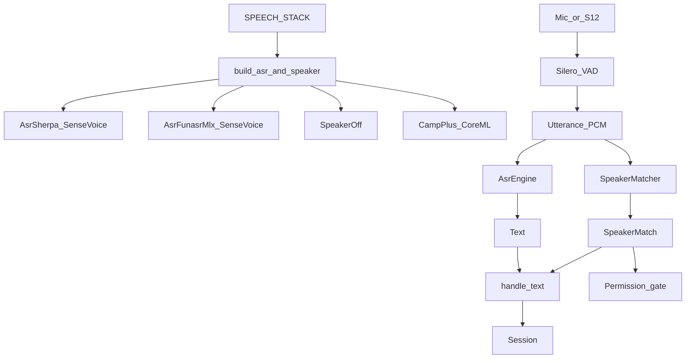

# Jarvis 双栈语音改造方案（可切换 ASR + 音色识别）

## 调研结论

**现状**（[jarvis/app.py](jarvis/app.py) / [jarvis/asr.py](jarvis/asr.py)）：硬编码 `SenseVoice`（sherpa-onnx），无声纹；§5.5 规划了称呼/权限/个性化。

**本期拍板**：ASR 层做成**可切换模式**，两套方案一键切换：

| `SPEECH_STACK` | ASR | 声纹 | 依赖 |
|----------------|-----|------|------|
| `sherpa`（默认，现网） | SenseVoice via sherpa-onnx | 默认关（可单独开 CAM++） | 现有 `asr` extra |
| `funasr_mlx` | SenseVoiceSmall via FunASR-MLX | **默认开** CAM++ CoreML | `funasr-mlx` + `coremltools` |

切换方式：改 `.env` 里一行 `SPEECH_STACK=...` 后重启 Jarvis（进程内各加载一套模型，不做热重载）。

## 目标能力

1. **快速切换**：`SPEECH_STACK` 预设绑定 ASR + 声纹默认；细项可被 `ASR_BACKEND` / `SPEAKER_ID_ENABLED` 覆盖
2. **统一接口**：主循环只调 `asr.transcribe(pcm)` / `speaker.identify(pcm)`，不知后端
3. **声纹**（funasr_mlx 栈默认开）：登记、余弦匹配、Session 透传、危险操作硬门控
4. **不做**：热切换不重启、流式 ASR 替换 VAD 整句路径、用声纹替代 KWS

## 架构



插入点不变：VAD 整句后进入 `handle` / wake `_take`；声纹与 ASR 首版串行。

## 实现分层

### 1. ASR 可切换抽象（核心变更）

**协议**（放在 [jarvis/asr.py](jarvis/asr.py) 作门面）：

```python
class AsrEngine(Protocol):
    load_ms: float
    def transcribe(self, pcm: np.ndarray) -> tuple[str, float]: ...
    def transcribe_file(self, path: str | Path) -> tuple[str, float]: ...
```

- [jarvis/asr_sherpa.py](jarvis/asr_sherpa.py)：现有 `SenseVoice` 原样迁入（行为零 diff）
- [jarvis/asr_funasr_mlx.py](jarvis/asr_funasr_mlx.py)：`FunasrMlxSenseVoice`，进程内常驻模型；`transcribe` 接受 16 kHz float32（必要时写临时 wav 或走官方 numpy API）
- `build_asr(settings) -> AsrEngine`：按 `ASR_BACKEND`（由 `SPEECH_STACK` 默认填充）工厂创建
- [jarvis/app.py](jarvis/app.py)：`self.asr = build_asr(self.st)`，删除对具体类的 import

FunASR-MLX 默认 checkpoint：`sensevoice-mlx-fp16`（与现网 SenseVoice 同族，切换代价最小）；目录 `ASR_MLX_MODEL_DIR`（默认 `models/sensevoice-mlx-fp16`）。

### 2. 配置预设

[jarvis/config.py](jarvis/config.py) / `.env.example`：

```text
SPEECH_STACK=sherpa          # 或 funasr_mlx
# 以下可覆盖预设：
# ASR_BACKEND=sherpa|funasr_mlx
# SPEAKER_ID_ENABLED=0|1
# SPEAKER_BACKEND=coreml|mlx|off
```

预设解析（加载 Settings 时）：

- `sherpa` → `ASR_BACKEND=sherpa`，`SPEAKER_ID_ENABLED=0`（除非显式打开）
- `funasr_mlx` → `ASR_BACKEND=funasr_mlx`，`SPEAKER_ID_ENABLED=1`，`SPEAKER_BACKEND=coreml`

其它声纹 knobs（两栈共用）：

- `SPEAKER_MODEL_DIR=models/campplus-coreml`
- `SPEAKER_STORE=data/speakers/profiles.json`
- `SPEAKER_THRESHOLD=0.65`
- `SPEAKER_MIN_SECONDS=1.5`

依赖 extras：

- 现有 `asr`：sherpa-onnx（sherpa 栈）
- 新增 `asr-mlx`：`funasr-mlx`（Apple Silicon）
- 新增 `speaker`：`coremltools`（CAM++ CoreML）

[scripts/fetch_models.sh](scripts/fetch_models.sh)：`sensevoice`（已有）、`sensevoice-mlx`、`campplus`。

### 3. 声纹模块（绑定 funasr_mlx 栈，sherpa 可选用）

**[jarvis/speaker_id.py](jarvis/speaker_id.py)**

- `CampPlusCoreML`：FluidInference **v2** 管线（preprocess → host mean-norm → embed → L2）
- `SpeakerStore` / `SpeakerMatcher`；`build_speaker(settings) -> SpeakerMatcher | NullSpeaker`
- 短句/失败 → `unknown`，不阻断对话
- 可选 `SPEAKER_BACKEND=mlx`：funasr-mlx `campplus` 作 fallback / parity

**[jarvis/speaker_enroll.py](jarvis/speaker_enroll.py)**：登记 CLI（wav / mic+cue）

### 4. 接入主循环与权限

- `handle(pcm)` / wake `_take`：`text = asr.transcribe`；若声纹开则 `match = speaker.identify`；日志 `👤 [爸爸 0.78] …`
- [jarvis/session.py](jarvis/session.py)：`【当前说话人】…`；unknown = 访客权限文案
- [jarvis/tools.py](jarvis/tools.py)：危险设备按 `role` 硬拒绝（仅声纹开启时）
- [config/prompt.md](config/prompt.md)：称呼与保守策略说明

### 5. 自检与切换验收

- `scripts/selftest_asr_backends.py`：同 wav 分别跑 sherpa / funasr_mlx，打印文本与耗时（不要求字面全等）
- `scripts/selftest_speaker_id.py` + CoreML↔MLX embedding cosine ≥ 0.99
- 切换验收：`.env` 改 `SPEECH_STACK` → 重启 → 启动日志打印 `speech_stack=… asr=… speaker=…` → 说一句确认 ASR 通路；funasr_mlx 栈再跑 enroll + 权限
- 回归：[.agents/skills/home-jarvis-voice-loop-regression/SKILL.md](.agents/skills/home-jarvis-voice-loop-regression/SKILL.md)；**默认 sherpa 行为与现网一致**

## 延迟与资源

| 栈 | ASR 预期 | 声纹 | 内存 |
|----|----------|------|------|
| sherpa | 200–400ms / 3s（现网） | 关则 0 | 现有 |
| funasr_mlx | 以本机实测为准（MLX SenseVoiceSmall） | CAM++ ≪ ASR | +MLX 权重 + ~15MB CoreML |

两套模型可同时落盘；进程只加载当前栈，避免双倍常驻（除非自检显式双开）。

## 风险与对策

| 风险 | 对策 |
|------|------|
| funasr-mlx experimental / API 变动 | 锁版本；AsrEngine 隔离；默认栈仍为 sherpa |
| 双栈识别文本不一致 | 切换自检只比「能出字」；不强制 CER 对齐 |
| CoreML v2 文件名变更 | fetch 锁定 HF commit + 文件名校验 |
| 误配 SPEECH_STACK 缺依赖 | 启动时清晰报错：缺哪个 extra / 哪个模型目录 |
| sherpa 栈误开声纹缺 coremltools | `SPEAKER_ID_ENABLED=1` 时加载失败则 warn + NullSpeaker，不拖垮 ASR |

## 实施顺序

1. AsrEngine 协议 + sherpa 迁出 + `build_asr`（行为零 diff，默认仍 sherpa）
2. FunASR-MLX SenseVoice 后端 + fetch + `SPEECH_STACK` 预设
3. CAM++ CoreML + SpeakerStore/enroll + `build_speaker`
4. 接入 handle/wake + Session + 权限门控
5. 双后端自检 + parity + voice-loop 回归（先 sherpa，再 funasr_mlx）
