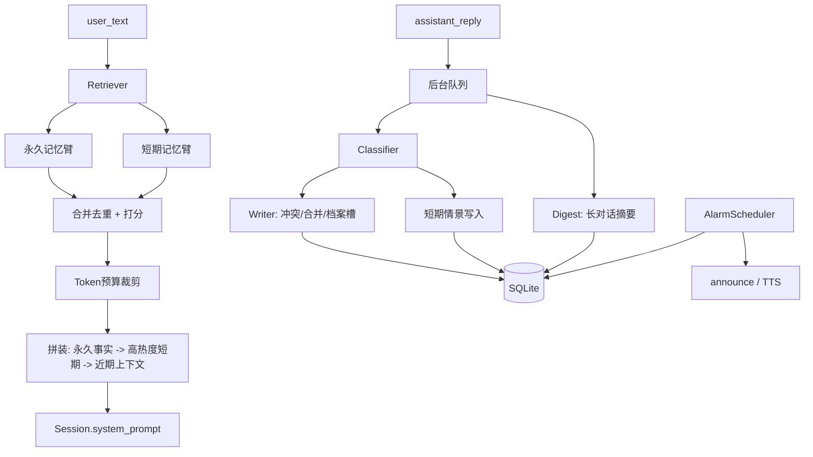

## 目标与边界

- 存储全本地：单文件 SQLite（WAL）+ 本地 ONNX embedding，无网络依赖；`MEMORY_ENABLED=false` 时行为与现网完全一致。
- 热路径只做「召回」，目标 P95 < 50ms；分类、去重、摘要、固化全部丢到后台单线程队列，语音不等。
- 出问题一律降级：模型/向量不可用 → 退化为纯关键词召回；记忆库异常 → 打日志并跳过，绝不打断 `handle_text`。

## 架构

## 数据模型（`data/memory/jarvis_memory.sqlite3`）

- `memories`：`id, layer('perm'|'short'), type, slot, content, summary, tags(json), importance, heat, recall_count, created_at, last_activity_at, last_recall_at, half_life_days, is_archived, superseded_by, session_id, source, ttl_at`
- `memory_vec`：`memory_id, model, dim, vec(BLOB float32)`；维度不匹配时视为 miss（换模型可后台重算）。
- `memory_fts`：FTS5 external-content 覆盖 `content/summary/tags`。中文用「逐字切分后建索引 + 查询同样切分」写进 unicode61（实测本机 trigram 对 2 字词无效，见验证）。
- `turn_log`：每会话最近 40 轮原文环形缓冲（不向量化，仅用于指代和摘要原料）。
- `alarms`：`id, fire_at, repeat_rule('once|daily|weekly'), label, memory_id, status, fired_at, missed_at`。
- `tombstones`：`slot, content_hash, created_at`，30 天内阻止「刚被擦除的内容」被历史回放再次学回来。
- `memory_events`：写/合并/冲突替代/擦除审计（不含原文，只存 id + 摘要 hash）。
- `.gitignore` 增加 `data/`。

记忆类型（`type`）固定枚举，避免分类器自由发挥：
- perm：`profile`（基础档案，slot 如 `name/city/home`）、`preference`（slot 如 `food.apple`）、`rule`（用户给的行为规则）、`task`（一次性/周期性提醒事项）
- short：`episode`（情景/事件摘要）、`context`（临时约定）、`digest`（对话压缩摘要）

## 1. 衰减与热度（`jarvis/memory/decay.py`，纯函数 + 单测）

- 永久记忆 `decay_lambda=0`，`score = importance`（不随时间掉）。
- 短期记忆默认 `MEMORY_SHORT_HALF_LIFE_DAYS=180`（180 天半衰期）；`docs/记忆设计.md` 里原有的「6 小时」作为同一参数的一行切换（`=0.25`）保留说明。
- 时间衰减：`decay = 2 ** (-(now - last_activity_at) / half_life)`，`last_activity_at` 在创建与被召回时都刷新。
- 热度：`heat = clamp(importance * decay + 0.25 * recency_of_recalls, 0, 1)`，其中 `recency_of_recalls` 由近 N 次召回时间做指数加权；召回命中时 `heat += 0.15`（上限 1）、`recall_count += 1`。
- 归档：短期 `heat < 0.08` 且 `age > 30d` → `is_archived=1`（默认不召回，`deep_recall=true` 才取）；`task` 过期后自动 `is_archived=1`。
- 所有阈值/权重集中为常量 + env 可调，便于实测调参。

## 2. 记忆分类器（`jarvis/memory/classifier.py`）

- 规则快路径（0 延迟、不发 LLM）：`记住…/以后都…/我叫…/我家在…/别再…/忘掉…/提醒我…/每天…点` 命中直接产出结构化草稿。
- 其余走 LLM（复用现有网关，`MEMORY_LLM_MODEL` 可覆盖，超时 6s、失败静默）：要求返回严格 JSON：
  `{should_store, layer, type, slot, content, summary, importance, tags[], conflict_hint, profile_key, schedule{hint,at,repeat}, erase{target|slot|all}}`
- 采信门槛：`should_store && importance >= MEMORY_MIN_IMPORTANCE(0.45)`；纯闲聊/情绪/工具回执不入库。
- 入队时机：`app.handle_text` 拿到 reply 后 `memory.observe_turn(session_id, user_text, reply)`；worker 串行消费，队列满丢弃最旧并告警。

## 3. 写入：纠正冲突 + 合并（`jarvis/memory/writer.py`）

写入前先在同 `layer+type` 内取候选（同 `slot` 优先，其次向量相似度 > 0.86），然后决策：

- 完全相同 / 近似（cos > 0.95 或同 slot 同值）：不新增，刷新 `last_activity_at` + `importance = max(old, new)`，累加 heat。
- 同 slot 不同值（如 `food.apple`：不喜欢 → 喜欢）：**新值胜出**，旧行 `is_archived=1, superseded_by=新 id`，写 `memory_events(type='supersede')`；渲染时标注「（已更新）」，避免模型复述过期偏好。
- 语义互补（不同类型、槽位不同）：关键词/向量聚类（cos > 0.9，簇 >= 3 条）→ LLM 合并成一条 `summary`，原条目 `is_archived=1` 并记 `merged_into`（沿用 `superseded_by` 字段）。
- `profile` 类型按 `slot` 唯一约束（name/city 等），新值直接覆盖旧值。
- 用户规则 `rule` 永不自动合并，只允许显式纠正/擦除（规则被悄悄改写风险最高）。
- `tombstones` 命中（同 slot 且内容 hash 相近）时拒绝写入，避免用户刚擦除又被下一条对话学回去。

## 4. 短期记忆与长对话压缩（`jarvis/memory/digest.py`）

- 每 `MEMORY_EPISODE_EVERY=6` 轮或连续静默 90s（进程内定时器）→ 后台把这段时间的 turn_log 摘要成 1-3 条 `episode`（含 importance），并清掉已摘要的原始轮次。
- 长对话：`Session.history` 超过 `MEMORY_COMPRESS_AT_MESSAGES=24` 时，保留最近 8 条原文，其余交给后台压缩成 `digest` 追加进会话摘要；压缩未完成时先用「较早对话已压缩」占位并截断，保证 token 不爆。摘要结果按 `session_id` 落库，重启后可恢复。
- 摘要文本也入 FTS + 向量，后续可以被短期臂召回。

## 5. 召回流水线（`jarvis/memory/retriever.py`）

在 `handle_text` 里同步执行，两路并行（`ThreadPoolExecutor(2)`）：

1. 查询准备：本地 embedding（懒加载，未就绪则跳过向量臂）+ 中文逐字切分后的 FTS5 查询 + 结构化槽位命中。
2. 永久臂：`layer='perm' AND is_archived=0`，`profile/rule` 全量取（量小），`preference/task` 走 slot + FTS + 向量 Top12。
3. 短期臂：`layer='short' AND is_archived=0`，向量/FTS Top20 → 按 `heat` 重排取 Top8。
4. 合并 + 重排打分：`score = 0.55*sim + 0.25*heat + 0.15*type_prior + 0.05*recency`；`MEMORY_RERANK=score|llm|off`：
   - `score`（默认）：纯计算 + 「同 slot 取最高」+ cos>0.92 近似去重 + 轻量 MMR 保多样性；
   - `llm`：候选 > 10 时额外一次批量打分剔除无关（可开关，默认关，避免给语音加 300ms+）。
5. Token 预算 `MEMORY_TOKEN_BUDGET=800`（CJK 按 ~1 token/字估算，另留 20% 余量），超出从尾部裁剪；每条带 `[m:xxxx]` id 供模型引用做纠正/遗忘。
6. 拼装顺序（严格按用户要求）：**永久事实（档案 → 规则 → 进行中提醒 → 偏好）→ 高热度短期 → 近期上下文摘要**，注入 `Session.system_prompt()` 的固定段落后、`【最近一次操作】` 之前，保持前缀稳定以利 prompt 缓存。

## 6. 提醒/闹钟持久化（`jarvis/memory/alarms.py`）

- 新增常驻调度线程（1s tick，墙钟 + 单调时钟校正），启动时从库加载 `status='pending'`：到期未超过 `MEMORY_MISSED_GRACE=600s` 就补报，否则标记 `missed` 并记一条 episode。
- 复用现有播报回调 `Tools(..., announce=...)`（[jarvis/tools.py](jarvis/tools.py) 的 `timer` 现在用内存 `threading.Timer`，重启即丢）：`timer` 工具保留原签名与返回文案，内部改为写 `alarms` 表（`once`，相对分钟）；新增绝对时间与 `daily/weekly` 重复规则，触发后自动算下一次。
- 触发时写一条短期 `episode`（「8:00 提醒吃药已播报」），并刷新关联 `task` 记忆热度。

## 7. 主动擦除遗忘（`jarvis/memory/eraser.py`）

- 三条入口：语音（分类器 `erase` 意图）、模型工具 `memory(action='forget')`、CLI `scripts/memory_cli.py erase`。
- 匹配顺序：显式 id → slot（`food.apple`）→ 标签 + 向量相似度阈值（默认 0.85）；命中多条时**先播报「要忘掉这几条吗」并等用户确认**，口语场景禁止静默批量删。
- 删除 = 物理删 `memories` + `memory_vec` + `memory_fts`，并写 tombstone（30 天）；关联 `alarms` 一并取消。
- 「清空所有记忆」必须二次确认（`确认清空`），且保留 `memory_events` 审计。
- 擦除后回复模板固定为「好，我忘了」，避免模型自由发挥说「我记着呢」。

## 8. 接入点

- [jarvis/app.py](jarvis/app.py:392)：`msgs = self.session.messages(text)` 前插入 `block = self.memory.build_context(text)`；reply 落库后 `self.memory.observe_turn(...)`；`Jarvis.__init__` 装配 `MemoryService`（含向量模型后台预热、alarm 调度启动）；`main` 的 `finally` 里 `memory.close()`。
- [jarvis/session.py](jarvis/session.py:45)：`system_prompt(memory_block="")` 增加注入位；`messages()` 透传；`_trim()` 改为「超出阈值触发后台压缩」。
- [jarvis/tools.py](jarvis/tools.py:295) + [jarvis/agent_tools.py](jarvis/agent_tools.py:89)：`schemas()` 增加 `memory` 工具（`remember/forget/list/correct/recall_alarms`）；`timer` 委托 alarms。
- [jarvis/config.py](jarvis/config.py:57) + `.env.example`：新增 `MEMORY_ENABLED / MEMORY_DB / MEMORY_MODEL_DIR / MEMORY_TOKEN_BUDGET / MEMORY_SHORT_HALF_LIFE_DAYS / MEMORY_MIN_IMPORTANCE / MEMORY_RERANK / MEMORY_RECALL_K / MEMORY_LLM_MODEL / MEMORY_EPISODE_EVERY / MEMORY_COMPRESS_AT_MESSAGES`。
- [config/prompt.md](config/prompt.md)：新增「记忆使用规则」——只把 `[m:id]` 段当作历史陈述、冲突时以「已更新」为准、用户说忘掉时调 `memory(forget)`、不得虚构记忆里没有的事实。
- `pyproject.toml`：新增 optional extra `memory = ["onnxruntime>=1.18"]`（`tokenizers` 已在依赖树）；[scripts/fetch_models.sh](scripts/fetch_models.sh) 增加 `memory` 目标，下载 `bge-small-zh-v1.5` int8 + tokenizer 到 `models/`。

## 9. 自检与验收

- `scripts/selftest_memory.py`（纯本地、不依赖真 LLM，分类器用 stub）：分类路由、冲突替代（苹果案例）、合并、180 天半衰期数值、召回加热、token 裁剪顺序、擦除 + tombstone 阻断回写、闹钟重启恢复与补报、长对话压缩、召回 P95 延迟。
- `scripts/memory_cli.py`：`list/search/erase/export/rebuild-index`（含 `--rebuild-vectors` 换模型重建）。
- 回归：[.agents/skills/home-jarvis-voice-loop-regression/SKILL.md](.agents/skills/home-jarvis-voice-loop-regression/SKILL.md) 的语音闭环用例，确认 `MEMORY_ENABLED=false` 与开启两种状态都通过；`scripts/selftest_llm.py` 不回归。
- 验收口径：说「记住我不吃香菜」→ 重启进程 → 问「今天吃什么」时 prompt 里有该偏好；说「我现在爱吃苹果了」→ 旧偏好被标 superseded；说「忘掉我不吃香菜」→ 该条消失且下轮不再召回；说「3 分钟后提醒我关火」→ 重启后仍会响。

## 实施顺序

1. `decay.py` + `store.py`（表结构、FTS 逐字索引、向量读写）+ 单测
2. `embedding.py` + `fetch_models.sh memory` + 降级路径
3. `classifier.py` + `writer.py`（冲突/合并/tombstone）
4. `retriever.py`（双路并行 + 打分 + 预算 + 拼装）
5. `digest.py`（episode + 长对话压缩）
6. `alarms.py`（持久调度 + `timer` 改造）
7. `eraser.py` + `memory` 工具 + CLI
8. 接入 `app.py` / `session.py` / `config.py` / `prompt.md`，更新 `docs/记忆设计.md`
9. 自检 + 语音回归 + 延迟实测调参