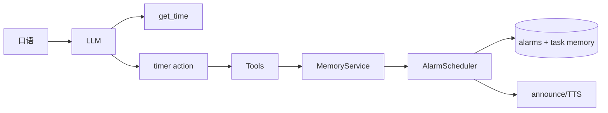

# 提醒 Tool API：取消 / 修改 / 绝对时间 / 重复

## 决策（已拍板）

- **不新建独立 `reminder` 工具**：在现有 eager [`timer`](jarvis/tools.py) 上扩展 `action`，取消/修改无需走 `tool_search`（与 [tool_search defer 计划](.cursor/plans/tool_search_defer_a1b68128.plan.md) 一致）。
- **绝对时间由模型填结构化字段**：参数 `at` 为本地墙钟 `YYYY-MM-DD HH:MM`（或带秒）；工具描述要求不确定「今天/星期几」时先调 `get_time`。不做重型中文时刻解析。
- **匹配规则**：`cancel` / `update` 优先 `alarm_id`；否则用 `query` 对 `label` 子串匹配。0 条→找不到；1 条→执行；多条→返回列表请用户说清，不擅自全删。仅当用户语义是「取消全部提醒」时传 `query=全部`（或 `cancel_all=true`）才清空 pending。
- **记忆关闭时**：仅保留相对 `minutes` 的内存 `threading.Timer`（现状）；`at` / `repeat!=once` / `cancel` / `update` / `list` 返回明确错误「需开启 MEMORY_ENABLED」。
- **终端态保留 7 天再物理删除**：`fired` / `missed` / `cancelled` 不永久堆积；`pending` 与仍在滚动的 `daily`/`weekly` 不清理。

## 工具契约

扩展 [`jarvis/tools.py`](jarvis/tools.py) 的 `timer` schema 与实现：

| 字段 | 用途 |
|------|------|
| `action` | `set`（默认）/ `cancel` / `update` / `list` |
| `minutes` | 相对分钟（与现网兼容） |
| `at` | 绝对本地时间字符串 |
| `repeat` | `once` \| `daily` \| `weekly`（默认 `once`） |
| `label` | 提醒文案 |
| `alarm_id` | 精确指定 |
| `query` | 按文案匹配；`全部` 表示 cancel 全部 |

`set` 规则：`minutes` 与 `at` 二选一（都有则以 `at` 为准）；`at` 必须落在未来（`daily`/`weekly` 若已过则由服务端滚到下一次，见下）。取消 600 分钟上限对 `at` 不适用；相对 `minutes` 仍限制在合理范围（例如 ≤ 7 天换算分钟，避免误填）。

`agent_tools` 从 `Tools.schemas()` 生成，无需另写 schema。

## 服务层

在 [`jarvis/memory/service.py`](jarvis/memory/service.py) 将 `schedule_timer` 泛化为统一入口，例如：

- `schedule_reminder(*, minutes=None, at=None, label="", repeat="once")` → 写 perm `task` + `alarms.schedule_in` / `schedule_at`
- `cancel_reminder(*, alarm_id="", query="")` → 取消 alarm；若有 `memory_id` 则删除/归档对应 task（复用 eraser 或 `cancel_alarms_for_memory` 的逆操作：先 cancel alarm，再删 memory）
- `update_reminder(*, alarm_id="", query="", minutes=None, at=None, label=None, repeat=None)` → `store.update_alarm` + 同步 task 文案
- `list_reminders()` → 复用现有 `recall_alarms` 格式

[`jarvis/memory/alarms.py`](jarvis/memory/alarms.py) 补充：

- `find_pending(query)`：label 子串（大小写不敏感）
- `reschedule(alarm_id, fire_at=..., repeat_rule=..., label=...)` 薄封装
- `parse_at(at: str) -> float`：严格解析本地时间
- 对 `daily`/`weekly`：若解析出的 `fire_at <= now`，用现有 `_next_fire` 滚到下一次再入库（保证「每天 8 点」在 9 点说也能设上）
- **7 天清理**：见下节

## 终端态清理（保留 7 天）

- 保留天数：`MEMORY_ALARM_RETENTION_DAYS`（缺省 7），写入 [`config.py`](jarvis/config.py) / `.env.example`。
- 结束时刻：`COALESCE(fired_at, missed_at, created_at)`。`cancel_alarm` 改为 `status='cancelled'` 且 `fired_at=now`（用 `fired_at` 作关闭时间，避免无时间戳时回落到 `created_at` 导致「设了很久才取消」被提前清掉）。
- [`MemoryStore`](jarvis/memory/store.py) 增加 `purge_terminal_alarms(cutoff: float) -> int`：`DELETE FROM alarms WHERE status IN ('fired','missed','cancelled') AND COALESCE(fired_at, missed_at, created_at) < ?`。
- 触发：`AlarmScheduler.start()` 启动时跑一次；调度 loop 内每小时再跑一次（记录上次 purge 的 monotonic，避免每 tick 打库）。
- **只删 `alarms` 行**，不删关联 perm `task` 记忆（避免误伤「每天吃药」类事实）；用户要忘掉事项仍走 memory forget。

## 数据流

## 其它接线

- [`config/prompt.md`](config/prompt.md)：补一条——设/改/取消/查提醒直接调 `timer`（eager），不要 tool_search；绝对时间先 `get_time` 再填 `at`。
- `memory.recall_alarms`：保留，内部转调 `list_reminders`，避免双实现。
- 分类器 observe 路径（[`service._handle_observe`](jarvis/memory/service.py)）：若 `draft.schedule` 含可解析的 `at` 或相对分钟，统一走 `schedule_reminder`（顺带接通「明天 8 点」类 LLM 分类结果）；本期不做独立口语取消规则（取消走工具）。

## 测试与文档

- [`scripts/selftest_memory.py`](scripts/selftest_memory.py)：绝对时间入库、`daily` 过期滚次、`cancel`/`update`、重启后 pending 仍在、终端态超 7 天被 purge / 未满 7 天保留。
- [`scripts/selftest_tools.py`](scripts/selftest_tools.py)：`timer(action=set/list/cancel/update)` 在假 memory / 无 memory 边界。
- [`docs/记忆设计.md`](docs/记忆设计.md)：验收口径补「明天 X 点 / 每天 / 取消 / 改到 / 已结束提醒保留 7 天」。

## 非目标

- 不引入 cron 表达式、工作日、农历。
- 不在本机做「下周三下午三点」中文解析（交给 LLM + `get_time` + `at`）。
- 不改播报通道（仍走现有 alarm → announce）。
- 不因 alarm purge 自动删除 task 记忆。
