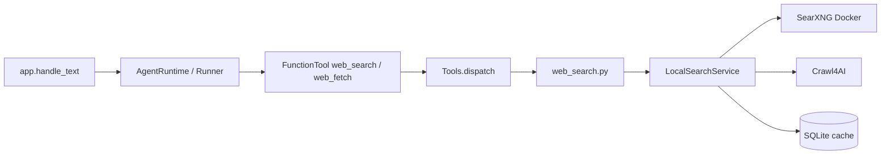

# SearXNG + Crawl4AI 联网搜索改造

## 架构决策

Jarvis **已硬切**到 OpenAI Agents SDK（见 [jarvis/agent_runtime.py](jarvis/agent_runtime.py)、[jarvis/agent_tools.py](jarvis/agent_tools.py)、[.cursor/plans/agents_sdk_migration_84dbcaf3.plan.md](.cursor/plans/agents_sdk_migration_84dbcaf3.plan.md)）。

家电工具约定不变：**领域逻辑留在 [jarvis/tools.py](jarvis/tools.py)**，由 `build_function_tools()` 从 `Tools.schemas()` 生成 `FunctionTool` 挂到 Agent。联网搜索走同一路径，不另开 MCP，也不直接接入 `local-web-search` 的 `[agents]` / `build_agent_tools()`（包内 helpers 仅作契约参考）。

接入路径定为：

- 依赖 **`local-web-search` 基础包**（`LocalSearchService`）；可选 extra，避免默认装 Playwright/Crawl4AI
- 在 [jarvis/web_search.py](jarvis/web_search.py) 做薄封装；[jarvis/tools.py](jarvis/tools.py) 增加 `web_search` / `web_fetch` schema + dispatch
- [jarvis/agent_tools.py](jarvis/agent_tools.py) **无需改表**：已按 `schemas()` 自动包装；开关仍由 `web_search_enabled` 控制是否出现在 schemas 里



## 关键约束：事件循环

`AgentRuntime` 用**常驻后台 loop 线程**跑 `Runner.run`；`FunctionTool.on_invoke` 是 async，内部同步调用 `Tools.dispatch`。

因此 **不能**在工具里裸调 `asyncio.run(...)`（会撞上「loop 已在运行」）。`web_search.py` 的 sync 桥接必须：

- 无运行中 loop 时：`asyncio.run(coro)`（自检 / 脚本）
- 已在 Agents loop 内：把 `asyncio.run(coro)` 丢到**独立线程**（`ThreadPoolExecutor` / 短命 worker），避免嵌套 loop；或等价地 `new_event_loop` + `run_until_complete` 跑在该线程

语音场景下 crawl 可能十余秒，阻塞的是工具调用线程/worker，不应饿死 Agent loop 上的其它调度；独立线程桥接正好满足这一点。

## 核心改动

### 1. 重写 [jarvis/web_search.py](jarvis/web_search.py)

删除百度 HTML 解析路径，改为薄封装：

- 懒加载单例 `LocalSearchService.from_env()`
- **async-safe** sync 桥接（见上）
- `search(query, *, count, language="zh-CN") -> str`：调用 `service.search`，序列化紧凑结果给模型（保留 `result_id`、`title`、`url`、`snippet`、`full_text_command_text`）；失败返回固定句（沿用 `FAIL` 语义）
- `fetch(result_id=..., url=..., start=0, max_chars=...) -> str`：调用 `service.fetch`，返回正文切片 + `has_more` / `next_fetch_command_text`
- 超时/条数从 Settings 传入；语音场景默认 crawl 约 **15s**、`max_chars` 默认 **3000**（覆盖包内 45s / 4000 偏长默认）

### 2. 扩展 [jarvis/tools.py](jarvis/tools.py)

- `web_search(query)`：走新后端；schema 说明「只返回摘要和 result_id，细节需再调 web_fetch」
- 新增 `web_fetch(result_id, start=0, max_chars=None)`（可选 `url` 兜底）；仅在 `web_search_enabled` 时与 search 一并注册
- `dispatch` 增加 `web_fetch`；关闭时返回「网页搜索未启用」
- 参数保持精简（语音模型易填错）：search 只要 `query`；fetch 主路径只要 `result_id`
- **不改** [jarvis/agent_tools.py](jarvis/agent_tools.py)：新 schema 会自动变成 FunctionTool；`_note` 对 search/fetch 不记 `session.note_action`（现状即可）

### 3. 更新 Agent 指令 [config/prompt.md](config/prompt.md)

规则 5 改为明确两步（写入 `session.system_prompt` / Agent `instructions` 同源文案）：

- 新闻/价格/营业时间/攻略等用 `web_search`
- **先 search 拿摘要和 `result_id`；在依赖页面细节之前，必须再调 `web_fetch(result_id=...)` 取全文**
- 摘要已够答的短问题可不 fetch
- 天气仍只用 `weather`，禁止用 search/fetch 查天气
- 最终仍用一两句口语回答；查不到直说「暂时查不到」

### 4. 配置 [jarvis/config.py](jarvis/config.py) + [.env.example](.env.example)

保留 `WEB_SEARCH_ENABLED` / `WEB_SEARCH_COUNT`；调整并新增：

- `SEARXNG_BASE_URL`：默认 `http://127.0.0.1:8888`
- `WEB_SEARCH_TIMEOUT`：SearXNG 请求超时（秒），默认约 8（可覆盖现百度用的 3s 默认）
- `WEB_FETCH_TIMEOUT`：Crawl4AI 超时（秒），默认约 15
- `WEB_FETCH_MAX_CHARS`：单次 fetch 切片，默认 3000
- `LOCAL_WEB_SEARCH_CACHE`：可选，默认 `.cache/local_agentic_search.sqlite3`（加入 [.gitignore](.gitignore)）

注释改为 SearXNG + Crawl4AI，去掉百度说明。

### 5. SearXNG 部署 [docker/docker-compose.yml](docker/docker-compose.yml)

在现有 HA compose 中增加 `searxng` 服务（`127.0.0.1:8888:8080`，JSON API 可用）。Jarvis **不**自动 `docker compose up`；启动失败时工具返回明确失败句，避免语音卡死。

README / `.env.example` 补：`docker compose -f docker/docker-compose.yml up -d searxng`，以及首次 `crawl4ai-setup`。

### 6. 依赖 [pyproject.toml](pyproject.toml)

新增 optional extra，避免默认装上 Crawl4AI/Playwright：

```toml
web = ["local-web-search>=0.1.6"]
```

安装：`uv sync --extra web`（与已有 `openai-agents` 主依赖并存）。`web_search_enabled=true` 但包未装时，工具返回可读错误提示。

不装 `local-web-search[agents]`：工具挂载由 Jarvis 自己的 `agent_tools` 完成。

### 7. 自检与 Agents 编排兼容

- 重写 [scripts/selftest_web_search.py](scripts/selftest_web_search.py)：去掉百度 fixture；改为结果格式化/mock + schema 含 `web_search`/`web_fetch`；`--live` 需本机 SearXNG；可顺带断言 `build_function_tools` 能包出同名工具
- [jarvis/llm_fake.py](jarvis/llm_fake.py)、[jarvis/app.py](jarvis/app.py) 的 `force_tool=web_search` **保持不变**（拒答时仍强制 search；fetch 靠 prompt / 后续 turn）
- [jarvis/agent_runtime.py](jarvis/agent_runtime.py) 的 `max_rounds=3` → `Runner.max_turns=3`，足够覆盖 search → fetch → 终答；fetch 超时偏长时靠 `_total_timeout` 余量，暂不改默认 rounds
- 整体超时：`_total_timeout` 按 LLM timeout × turns；若 live crawl 常踩线，再单独把 fetch 计入余量或略增 `max_rounds`（落地时再定，首版不改）

## 明确不做

- 不把联网搜索做成 MCP server（首期仍是本地 FunctionTool）
- 不改用 `local-web-search` 的 `build_agent_tools()` 替代 Jarvis 工具包装层
- 不保留百度 SERP 回退（单一后端）
- 不在 Jarvis 进程内自动拉起 Docker 容器
