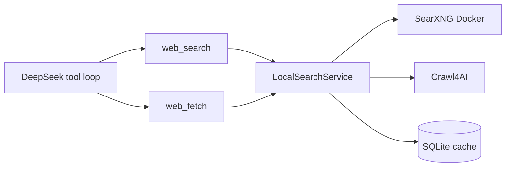

# SearXNG + Crawl4AI 联网搜索改造

## 架构决策

Jarvis 当前是 **DeepSeek chat completions + 自定义 `Tools.dispatch`**（见 [jarvis/tools.py](jarvis/tools.py)、[jarvis/llm.py](jarvis/llm.py)），**不是** OpenAI Agents SDK。

因此接入路径定为：

- 依赖 **`local-web-search` 基础包**（`LocalSearchService`），**不装** `[agents]` / `openai-agents`
- 在 Jarvis 侧手写 Chat Completions 风格的 `web_search` / `web_fetch` schema 与 sync 包装
- 包内 `responses_tool_schemas()` / `build_agent_tools()` 仅作契约参考，不直接接入



## 核心改动

### 1. 重写 [jarvis/web_search.py](jarvis/web_search.py)

删除百度 HTML 解析路径，改为薄封装：

- 懒加载单例 `LocalSearchService.from_env()`
- sync 桥接：`asyncio.run(...)`（Jarvis 工具层是同步的；主路径无运行中的事件循环，可直接 `asyncio.run`）
- `search(query, *, count, language="zh-CN") -> str`：调用 `service.search`，序列化紧凑结果给模型（保留 `result_id`、`title`、`url`、`snippet`、`full_text_command_text`）；失败返回固定句（沿用 `FAIL` 语义）
- `fetch(result_id=..., url=..., start=0, max_chars=...) -> str`：调用 `service.fetch`，返回正文切片 + `has_more` / `next_fetch_command_text`
- 超时/条数从 Settings 传入；语音场景默认 crawl 约 **15s**、`max_chars` 默认 **3000**（覆盖包内 45s / 4000 偏长默认）

### 2. 扩展 [jarvis/tools.py](jarvis/tools.py)

- `web_search(query)`：走新后端；schema 说明「只返回摘要和 result_id，细节需再调 web_fetch」
- 新增 `web_fetch(result_id, start=0, max_chars=None)`（可选 `url` 兜底）；仅在 `web_search_enabled` 时与 search 一并注册
- `dispatch` 增加 `web_fetch`；关闭时返回「网页搜索未启用」
- 参数保持精简（语音模型易填错）：search 只要 `query`；fetch 主路径只要 `result_id`

### 3. 更新 Agent 指令 [config/prompt.md](config/prompt.md)

规则 5 改为明确两步：

- 新闻/价格/营业时间/攻略等用 `web_search`
- **先 search 拿摘要和 `result_id`；在依赖页面细节之前，必须再调 `web_fetch(result_id=...)` 取全文**
- 摘要已够答的短问题可不 fetch
- 天气仍只用 `weather`，禁止用 search/fetch 查天气
- 最终仍用一两句口语回答；查不到直说「暂时查不到」

### 4. 配置 [jarvis/config.py](jarvis/config.py) + [.env.example](.env.example)

保留 `WEB_SEARCH_ENABLED` / `WEB_SEARCH_COUNT`；调整并新增：

- `SEARXNG_BASE_URL`：默认 `http://127.0.0.1:8888`
- `WEB_SEARCH_TIMEOUT`：SearXNG 请求超时（秒），默认约 8
- `WEB_FETCH_TIMEOUT`：Crawl4AI 超时（秒），默认约 15
- `WEB_FETCH_MAX_CHARS`：单次 fetch 切片，默认 3000
- `LOCAL_WEB_SEARCH_CACHE`：可选，默认 `.cache/local_agentic_search.sqlite3`（加入 [.gitignore](.gitignore)）

注释改为 SearXNG + Crawl4AI，去掉百度说明。

### 5. SearXNG 部署 [docker/docker-compose.yml](docker/docker-compose.yml)

在现有 HA compose 中增加 `searxng` 服务（`127.0.0.1:8888:8080`，JSON API 可用）。Jarvis **不**自动 `docker compose up`；启动失败时工具返回明确失败句，避免语音卡死。

README / `.env.example` 补：`docker compose -f docker/docker-compose.yml up -d searxng`，以及首次 `crawl4ai-setup`。

### 6. 依赖 [pyproject.toml](pyproject.toml)

新增 optional extra，避免默认装上 Crawl4AI/Playwright：

```toml
web = ["local-web-search>=0.1.6"]
```

安装：`uv sync --extra web`。`web_search_enabled=true` 但包未装时，工具返回可读错误提示。

### 7. 自检与编排兼容

- 重写 [scripts/selftest_web_search.py](scripts/selftest_web_search.py)：去掉百度 fixture；改为结果格式化/mock + schema 含 `web_search`/`web_fetch`；`--live` 需本机 SearXNG
- [jarvis/llm_fake.py](jarvis/llm_fake.py)、[jarvis/app.py](jarvis/app.py) 的 `force_tool=web_search` **保持不变**（拒答时仍强制 search；fetch 靠 prompt）
- `max_rounds=3` 足够覆盖 search → fetch → 终答，暂不改

## 明确不做

- 不引入 OpenAI Agents SDK / 不重写整条 Agent Runner
- 不保留百度 SERP 回退（单一后端）
- 不在 Jarvis 进程内自动拉起 Docker 容器
