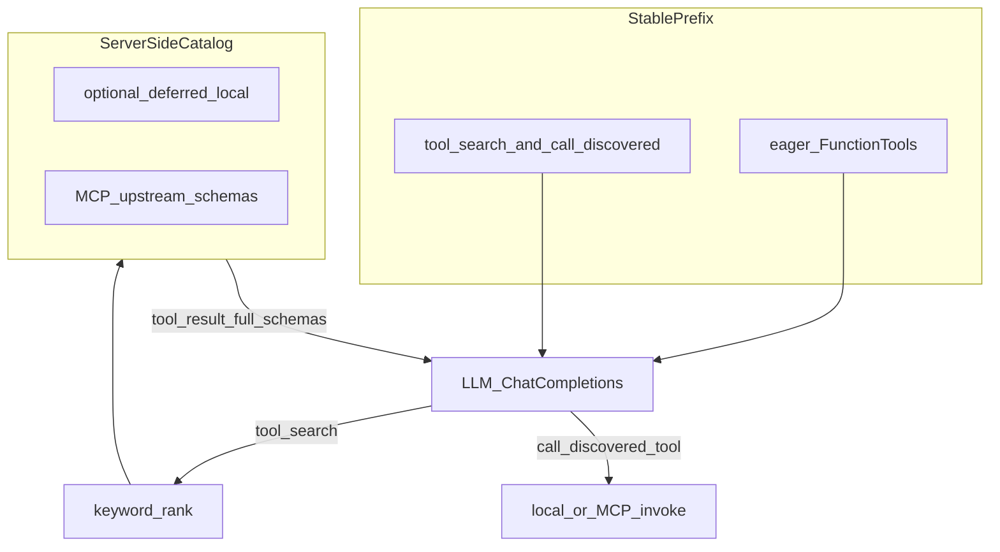

# Jarvis Tool Search（对齐 Anthropic defer_loading）

## 目标语义（对齐 Anthropic，而非搬 API）

Anthropic [Tool Search Tool](https://platform.claude.com/docs/en/agents-and-tools/tool-use/tool-search-tool) 的要点：

1. 请求里仍带着完整工具目录（服务端可搜）
2. 标了 `defer_loading: true` 的定义不进模型可见的 tools/system 前缀
3. 模型调搜索后，API 用 `tool_reference` 在对话里展开完整 schema
4. 前缀不变，prompt cache 不被「中途加载工具」打碎
5. 高频工具保持非 defer（官方建议 3–5 个）

OpenAI Agents SDK 虽有 `FunctionTool.defer_loading` + `ToolSearchTool()`，但文档写明是 Responses API + GPT-5.4+；Jarvis 当前是 [`OpenAIChatCompletionsModel`](jarvis/agent_runtime.py) + DeepSeek，不能开平台原生路径。因此做客户端等价实现，保留缓存友好的「稳定前缀」。

## 架构决策（已拍板）

- 原生 Anthropic / OpenAI `ToolSearchTool`：不做（模型/API 不兼容）
- 外部 smartmcp-router 进程：不做；逻辑进 Jarvis 进程
- 缓存策略：稳定 tools 数组；发现后不往 `Agent.tools` promote；完整定义只出现在 tool result（对话侧），等价 `tool_reference`
- 执行路径：固定元工具 `call_discovered_tool`（避免改 tools 前缀导致 cache miss）
- Eager（始终可见）：`control` `query` `announce` `scene` `timer` `get_time` `set_tts` + 两元工具；`weather` 因语音高频也保持 eager
- Deferred：全部 `MCP_SERVERS` 上游工具；默认把 `web_search` / `web_fetch` / `memory` 也 defer
- 检索：首期关键词 + 别名 + token 重叠；目录条目可挂可选 embedding（复用 memory embedder），无则跳过
- MCP 挂载：停止 `Agent(mcp_servers=...)` 全量暴露；连接仍用现有 `_ensure_mcp`，只作上游执行后端

## 核心模块

### 1. 工具目录 [`jarvis/tool_catalog.py`](jarvis/tool_catalog.py)（新）

- `ToolEntry`：`name`, `description`, `parameters`, `aliases`, `source` (`local`|`mcp`), `server`, `defer`
- `ToolCatalog.build(local_schemas, mcp_servers)`：启动/连上 MCP 后刷新
- `search(query, limit=5)`：name/desc/aliases 子串 + 简单分词打分；可选向量重排
- `get(name)` / `format_discovery(entries)`：紧凑 JSON schema 列表（供 tool result）

### 2. 元工具 [`jarvis/tool_search.py`](jarvis/tool_search.py)（新）+ 接入 [`jarvis/agent_tools.py`](jarvis/agent_tools.py)

- `tool_search(query, limit=5)`：搜 `defer=True` 条目；写入 `ToolBag.discovered`；返回 discovery 全文
- `call_discovered_tool(name, arguments)`：仅允许已 discovered；`local` 走 `Tools.dispatch`，`mcp` 在 agent loop 上对对应 server `call_tool`
- 两工具永不 defer；始终进 eager 列表

`ToolBag` 增：`catalog`, `discovered: set[str]`；每轮 `chat()` 开头清空 discovered。

### 3. Runtime 改造 [`jarvis/agent_runtime.py`](jarvis/agent_runtime.py)

- `_ensure_mcp` 连接后：`list_tools` 写入 catalog，不再 `clone(..., mcp_servers=active)`
- `Agent.tools` = eager FunctionTools only
- `max_turns` 默认 3 → 4（search → call → 终答余量）
- `force_tool`：意图落在 defer 工具时改为强制 `tool_search`；同步改 intent/guard

### 4. Prompt [`config/prompt.md`](config/prompt.md)

- 家电/时间/天气/换 TTS：直接调对应 eager 工具
- 其它能力：先 `tool_search`，再按返回 schema 调 `call_discovered_tool`
- 不要求模型背 MCP 工具名

### 5. 配置 [`jarvis/config.py`](jarvis/config.py) + `.env.example`

- `TOOL_SEARCH_ENABLED`（默认 true；false 回退本地全量 + MCP 全量挂载）
- `TOOL_SEARCH_DEFER_LOCAL` 默认 `web_search,web_fetch,memory`
- `TOOL_SEARCH_LIMIT` 默认 5

### 6. 自检

- [`scripts/selftest_agent_runtime.py`](scripts/selftest_agent_runtime.py)：MCP echo 改为「不在 eager → tool_search 命中 → call_discovered_tool」
- 新 `scripts/selftest_tool_search.py`：索引、命中、未 discovered 拒绝、开关回退

## 明确不做

- 不引入 Anthropic API / 不切换 GPT-5.4 Responses 作为本阶段前置
- 不把 `control`/`query` 等家电工具放进 defer
- 不把技能 SKILL.md 渐进披露并进本 PR（可后续用同一 catalog 的 `kind=skill`）
- 不改 memory 召回链路；仅 `memory` 工具可 defer

## 关键文件

- 新：`jarvis/tool_catalog.py`, `jarvis/tool_search.py`
- 改：`jarvis/agent_tools.py`, `jarvis/agent_runtime.py`, `jarvis/tools.py`, `jarvis/config.py`, `config/prompt.md`, intent/guard, 自检脚本
