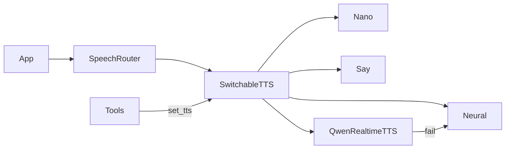

# TTS 可切换后端（本地 + 千问 Realtime TTS）

## 目标

- 统一装配：一个入口按名字创建/切换后端，接口与现有 `SayTTS`/`SherpaTTS`/`NanoTTS` 对齐（`speak/stop/warm/play_cached/wait_idle/synthesize` + `voice`/`mode`/`speaking`）。
- 首批云端：**千问AI平台 Realtime API**（WebSocket Inference，CosyVoice / Qwen-Audio-TTS），PCM 流式，失败回落本地 VITS。
- **运行中热切换**：LLM 工具 `set_tts`，口令如「换成云端音色 / 切回本地」。

文档依据：
- [Realtime API 概述](https://platform.qianwenai.com/docs/api-reference/realtime-api/overview)
- [WebSocket 接入概览](https://platform.qianwenai.com/docs/api-reference/realtime-api/websocket-overview)
- [CosyVoice WebSocket](https://platform.qianwenai.com/docs/api-reference/speech-synthesis/cosyvoice/websocket-api)

## 现状锚点

- 装配点：[`jarvis/tts_neural.py`](jarvis/tts_neural.py) 的 `build_local_tts`（`neural|nano|say`）。
- 消费点：[`jarvis/app.py`](jarvis/app.py) → `SpeechRouter.local`；打断/预渲染走同一套接口。
- 工具注册：[`jarvis/tools.py`](jarvis/tools.py) `schemas`/`dispatch`；口令靠 LLM 调工具（[`config/prompt.md`](config/prompt.md) 补一条规则）。

## 设计决策（已定）

1. **云端产品**：千问AI平台 Realtime WebSocket（服务端集成选 WebSocket，不用 AOQ/WebRTC）。
   - 地址：`wss://maas.qianwenaiapi.com/api-ws/v1/inference`
   - 鉴权：`Authorization: Bearer $DASHSCOPE_API_KEY`
   - 协议：`run-task` → `task-started` → 多次 `continue-task` → `finish-task` → `task-finished`；同任务共用 `task_id`
   - 默认模型：`cosyvoice-v3-flash`；默认音色：`longanyang`
   - 音频：`format=pcm`、`sample_rate=24000`，binary 帧边收边 `Speaker.play`，适配 S12 下行
   - 实现优先原生 WebSocket（`websockets`/`websocket-client`）；可选 `dashscope.Client(base_url=https://maas.qianwenaiapi.com/api/v1)` 的 `client.audio.tts.connect` 作对照冒烟
2. **热切换载体**：新增 `SwitchableTTS` 包一层；后端 **懒加载**（切到才建），当前活跃后端处理全部播报；切换时先 `stop()`，再对 ACK 短语异步 `warm`。
3. **持久化**：热切换只改进程内状态；重启仍读 `.env` 的 `TTS_BACKEND`（不做落盘）。
4. **回落**：`qwen`/`nano` 超时或鉴权失败 → `TTS_FALLBACK`（默认 `neural`），本句改用回落并进入短冷却（复用 nano 的冷却思路）。
5. **后端名**：`TTS_BACKEND=qwen`（别名可接受 `qianwen` / `cosyvoice`）。

## 实现步骤

### 1. 统一工厂 + 可切换包装

- 新增 [`jarvis/tts_registry.py`](jarvis/tts_registry.py)：
  - `build_backend(name, settings, speaker)`：`neural` / `nano` / `say` / `qwen`
  - `SwitchableTTS`：持有 `settings`+`speaker`、`_active`、懒加载缓存；`switch(backend, voice=None, sid=None) -> str`；其余方法代理到 `_active`
  - `voice` 展示为 `qwen(longanyang)` / `vits-…#sid` / `nano(zh_1)` 等，启动日志与热切换确认共用
- [`jarvis/tts_neural.py`](jarvis/tts_neural.py)：`build_local_tts` 改为薄封装调用 `build_tts`（或直接替换调用点）。
- [`jarvis/app.py`](jarvis/app.py)：`local_tts = build_tts(...)`，把 `SwitchableTTS` 交给 `SpeechRouter`，并把 `switch` 绑到 Tools。

### 2. 千问 Realtime TTS 后端

- 新增 [`jarvis/tts_qwen.py`](jarvis/tts_qwen.py) `QwenRealtimeTTS`：
  - WebSocket 连 `TTS_QWEN_WS_URL`；`run-task` 里设 `model`/`voice`/`format=pcm`/`sample_rate`
  - `speak`：`continue-task` 推文本（可按句），binary PCM → float32 队列边播；`stop` 关闭当前 task/连接并 `speaker.stop()`
  - 建议复用同一 WS 连接做多轮任务（每轮新 `task_id`）；打断时取消未完成 task
  - `warm`/`play_cached`：短 ACK 可整段缓存；失败走 `fallback`
- [`pyproject.toml`](pyproject.toml) 增加 WebSocket 客户端依赖（如 `websockets`）；冒烟脚本可另加可选 `dashscope`
- 配置（[`jarvis/config.py`](jarvis/config.py) + [`.env.example`](.env.example)）：
  - `TTS_BACKEND` 增加 `qwen`
  - `DASHSCOPE_API_KEY`（千问平台 API Key）
  - `TTS_QWEN_WS_URL=wss://maas.qianwenaiapi.com/api-ws/v1/inference`
  - `TTS_QWEN_MODEL=cosyvoice-v3-flash`
  - `TTS_QWEN_VOICE=longanyang`
  - `TTS_QWEN_SAMPLE_RATE=24000`
  - `TTS_QWEN_TIMEOUT=8`
  - `TTS_FALLBACK=neural`（统一 nano/qwen 回落；兼容旧 `TTS_NANO_FALLBACK`）

### 3. 热切换工具

- [`jarvis/tools.py`](jarvis/tools.py) 增加 `set_tts`：
  - 参数：`backend`∈`neural|nano|say|qwen`；可选 `voice`（say/qwen）、`sid`（neural）
  - 返回口语确认，例如「已切换到云端音色龙安阳」
  - 缺 Key / 侧车未就绪时明确失败原因，不静默假装成功
- [`config/prompt.md`](config/prompt.md) 增加规则：用户说换声音/换 TTS/用云端或本地时调 `set_tts`，不要只口头答应。

### 4. 文本归一化与输出路由

- [`jarvis/textnorm.py`](jarvis/textnorm.py) / 合成入口：`neural`/`nano` 继续本地数字归一化；**qwen/say 跳过**（云端自带数字展开）。
- [`jarvis/output.py`](jarvis/output.py)：`SpeechRouter.voice/mode` 在 `TTS_TARGET=local`（含 S12 endpoint）时透出 `SwitchableTTS` 的当前音色。

### 5. 自检与文档

- `scripts/selftest_tts_switch.py`：mock 后端验证 `switch` 代理与失败回落（无 Key 时跳过真实云端）。
- 可选冒烟：`scripts/try_qwen_tts.py`（有 Key 才跑一句 Realtime PCM）。
- 更新 [`docs/TTS-选型与实测.md`](docs/TTS-选型与实测.md) 与 README TTS 表：后端列表、千问 Realtime 接入、热切换工具、环境变量。

## 验收

1. `.env` `TTS_BACKEND=neural` 启动行为与现网一致。
2. 配置 `DASHSCOPE_API_KEY` 后 `TTS_BACKEND=qwen` 能从本机/S12 出声；断网或无 Key 时本句回落 neural 并打警告。
3. 运行中说「换成云端声音」→ 调 `set_tts(backend=qwen)` → 下一句音色变化；「切回本地」同理。
4. barge-in：云端播报中打断仍能 `stop` 停播。
5. `./scripts/selftest_all.sh` 相关项不过度依赖真实云账号。
