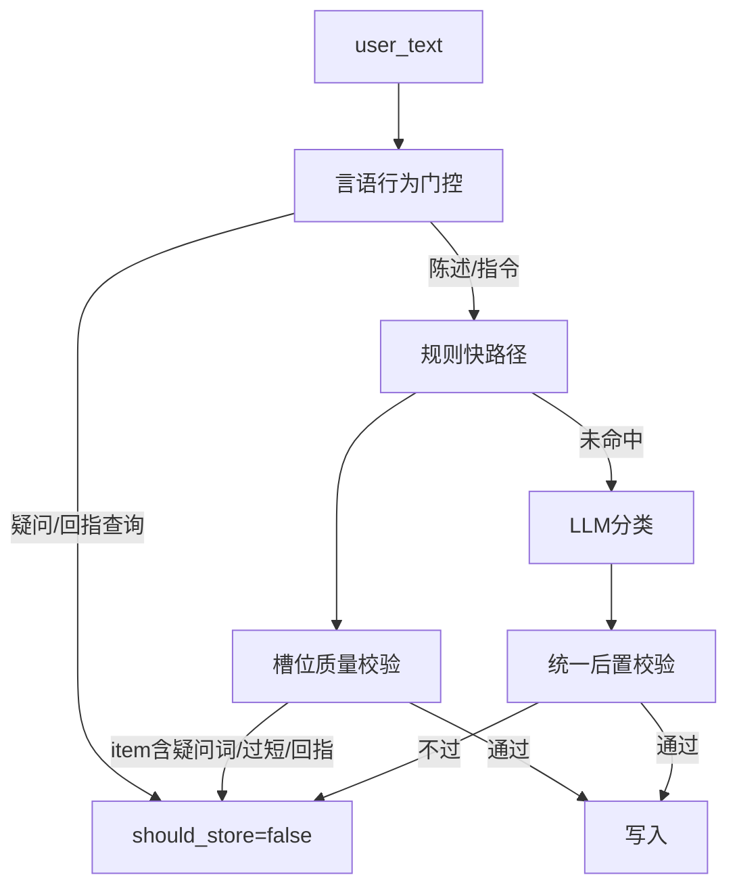

## 根因

[`jarvis/memory/classifier.py`](jarvis/memory/classifier.py) 偏好规则只看「喜欢/不喜欢」：

```124:153:jarvis/memory/classifier.py
    if _REMEMBER.search(t) or re.search(r"(喜欢|不喜欢|爱吃|不吃|讨厌)", t):
        m = _LIKE.search(t)
        if m:
            ...
            item = re.split(...)[0][:20]  # 「什么水果」被当成 item
            return ClassifyResult(should_store=True, type="preference", slot=f"food.{item}", ...)
```

「我喜欢吃什么水果？」命中 `喜欢` + `_LIKE`，`item=什么水果` → 写入 `food.什么水果`。规则命中后**不再走 LLM**，所以后台分类器无法自救。

## 方案：三层防护（全部本地、0 额外延迟）



### 1. 言语行为门控（最先执行）

在 `rule_classify` 入口增加 `_is_interrogative(t)`：

- 标点：`？` `?`
- 疑问词：`什么|哪个|哪些|哪样|几|多少|吗|呢|嘛|咋|怎么|如何|为何|是不是|有没有|能不能`
- 查询回指：`我喜欢吃什么|我喜欢什么|我都喜欢啥|还记得我.*吗`

命中且**不是**显式记忆指令（无「记住/忘掉/提醒我」）→ 直接返回 `ClassifyResult(should_store=False)`（不是 `None`），避免再落到偏好规则或 LLM 误判。

例外放行：`记住我不喜欢香菜吗` 这类带「记住」的确认句仍走记忆路径；`提醒我…吗` 仍走 remind。

### 2. 槽位 / item 质量校验

新增 `_valid_pref_item(item) -> bool`，任一命中即拒绝：

- 含疑问词：`什么|哪个|哪些|啥|几`
- 过短（&lt; 1 字）或过泛：`东西|那个|这个|水果|食物|运动`（单独出现且无具体修饰时）
- 纯语气词：`啊|呀|吧|呢`

偏好规则在构造 `slot` 前调用；失败则 `return None`（交给 LLM），不再硬写。

同时收紧 `_LIKE` 捕获：要求 item 至少像具体对象（汉字/英文，且不以疑问词开头），例如：

```python
_LIKE = re.compile(r"(不?喜欢|不?爱|不?想吃|不?吃|讨厌|偏好)\s*((?!什么|哪个|哪些|啥)[^\s，。！？,.?]{1,16})")
```

### 3. 统一后置校验 + 强化 LLM 负例

在 `classify()` 末尾对**所有** `should_store=True` 的结果跑 `_sanitize_draft(draft, user_text)`：

- 用户文本是疑问句且无记住/忘掉指令 → 强制 `should_store=False`
- `type=preference` 且 `slot`/`content` 含疑问词或 `food.什么*` → 拒绝
- `summary` 与用户原句几乎相同且原句是问句 → 拒绝

LLM prompt 补硬性负例（写入 [`_LLM_PROMPT`](jarvis/memory/classifier.py)）：

```
禁止存储：
- 疑问句（「我喜欢吃什么水果？」「还记得我过敏吗」）
- 对记忆的查询/核对，不是新事实
- 助手已经答过的回顾性内容
只有用户在陈述新事实或明确要求「记住/忘掉」时才 should_store=true
```

### 4. 顺带修 tool + observe 双写（香蕉案例）

[`service.py`](jarvis/memory/service.py) 的 `_handle_observe`：若本轮 `reply` 来自已成功的 `memory(remember)` 工具（turn_log 里助手已确认，或本轮 tool 结果可从 session 旁路标记），则跳过同 slot 的二次 observe 写入。

最小实现：在 `Tools.memory_tool(remember/forget)` 成功后设 `memory._skip_observe_once = True`；`observe_turn` 消费该标志，本轮只记 turn_log、不跑 preference 写入（erase 意图仍处理）。

### 5. 清理已有误记 + 自检

- 自检启动或 CLI 一次性：删除/归档 `slot` 匹配 `food.什么*` / `pref.什么*` 以及 content 含「喜欢什么」的活跃条（你库里的 `m_11c07ac7ee`）
- [`scripts/selftest_memory.py`](scripts/selftest_memory.py) 增加用例矩阵：

| 输入 | 期望 |
|------|------|
| 我喜欢吃什么水果？ | should_store=False |
| 我不喜欢吃香蕉 | preference / food.香蕉 |
| 我喜欢打羽毛球 | preference / pref.打羽毛球 |
| 记住我不吃香菜吗 | 仍可存储或走 remember（带记住） |
| 还记得我不吃香菜吗 | should_store=False |

## 改动文件

- [`jarvis/memory/classifier.py`](jarvis/memory/classifier.py) — 门控、item 校验、sanitize、prompt 负例（主改）
- [`jarvis/memory/service.py`](jarvis/memory/service.py) — tool/observe 去重标志
- [`jarvis/tools.py`](jarvis/tools.py) — `memory_tool` 成功时置标志
- [`scripts/selftest_memory.py`](scripts/selftest_memory.py) — 疑问句矩阵
- 可选：`scripts/memory_cli.py` 加 `scrub-bad` 或自检里自动清测试库；对用户现网库用 CLI erase 清 `m_11c07ac7ee`

## 不做

- 不上新模型、不加网络依赖
- 不把所有「喜欢」都交给 LLM（规则快路径保留，只加门控）
- 不改召回/衰减逻辑
